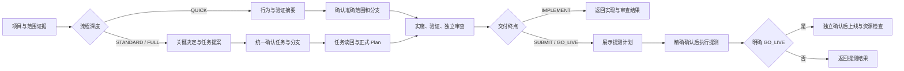

# Zan Workflows 团队使用指南

`zan-workflows` 是一组面向研发日常的 Codex Skills 和 MCP 连接。它把 TAPD 需求/Bug、代码范围确认、分支、Plan、实现评审、提测、Wiki、GitLab MR、上线和本地清理串成有明确交接与确认点的流程。

本文适合首次安装的团队成员。MCP 凭据按个人账号配置在本机；不要把凭据提交到仓库或发到聊天中。

## 主要流程入口

团队日常研发优先从下面两个编排入口开始。它们负责选择并串联专用能力；其他 Skill 通常由入口按阶段调用，也可以按需单独使用。

| Codex 显示名称 | 调用方式 | 适用场景 |
| --- | --- | --- |
| **zan:需求开发** | `$developing-requirement` | TAPD Story/Task：按复杂度选择摘要或正式 Plan → 分支与实现评审 → 按要求提测/上线 |
| **zan:修复 TAPD 缺陷** | `$fixing-bug` | 一个或多个 TAPD Bug：按复杂度准备 → 修复与审查；明确要求时才提测/上线 |

## 1. 能力地图

| Codex 显示名称 | Skill ID | 作用 | 类型 |
| --- | --- | --- | --- |
| zan:项目知识 | [`workspace-project-knowledge`](skills/workspace-project-knowledge/SKILL.md) | 统一查询项目知识，优先 Graphify Hub，必要时回退本地；定位项目、代码入口、Jenkins Job 和共享包归属 | 项目路由/知识入口 |
| zan:准备 TAPD 工作 | [`preparing-work`](skills/preparing-work/SKILL.md) | 只读读取 TAPD Bug、Story、Task，确认项目、仓库、范围、原始分支及创建/复用动作，输出内存交接定义 | 只读预检 |
| zan:可视化编写计划 | [`writing-plans`](skills/writing-plans/SKILL.md) | 按远程 `origin/master` 收敛需求和验收；QUICK 返回摘要，正式 Plan 继续按复杂度选择对话或面板 | 范围/Plan |
| zan:拆分需求任务 | [`breaking-down-requirement`](skills/breaking-down-requirement/SKILL.md) | 按需求拆分任务，核实开发人员，预估开发工时，确认清单后创建/更新 TAPD 并关联 Plan | 任务拆分/估时 |
| zan:实施 TAPD 工作 | [`implementing-work`](skills/implementing-work/SKILL.md) | 在已确认的固定分支实现变更，运行相关验证并独立评审；不负责提测或发布 | 实现/评审 |
| **zan:需求开发** | [`developing-requirement`](skills/developing-requirement/SKILL.md) | 按 QUICK/STANDARD/FULL 编排范围、分支、实施与验证，正式 Plan 按需生成，交付止于明确目标 | 需求主入口 |
| **zan:修复 TAPD 缺陷** | [`fixing-bug`](skills/fixing-bug/SKILL.md) | 对一个或多个 Bug 做统一预检与确认、顺序修复和审查；仅按明确交付目标提测或上线 | Bug 主入口 |
| zan:起草提测 Wiki | [`drafting-wiki`](skills/drafting-wiki/SKILL.md) | 只读定位现有提测 Wiki 或计算新 Wiki 正文，不直接写入 | Wiki 规划 |
| zan:补写提测 Wiki 链接 | [`linking-tapd-wiki`](skills/linking-tapd-wiki/SKILL.md) | 将已验证的提测 Wiki 链接幂等地添加到或核对 TAPD Bug、Story、Task 评论 | TAPD 评论 |
| zan:提交测试 | [`submitting-for-test`](skills/submitting-for-test/SKILL.md) | 在提测计划确认后，负责代码交付到 `develop`、可选 Jenkins 测试部署、Wiki、TAPD 评论/状态/测试版本 | 提测执行 |
| zan:上线发布 | [`going-live`](skills/going-live/SKILL.md) | 原分支合并 `master`；先检查工具包 latest，按需发布、升级并核验对应项目、更新 Wiki；验证后按单独确认清理本地环境 | 上线/清理 |
| zan:Jenkins 构建与发布 | [`running-release`](skills/running-release/SKILL.md) | 日常 dev/test 项目构建直接使用 MCP；正式发布、所有工具包发版及组合交付保留完整计划，均核验本次构建和源码 | 构建/部署/发包 |
| zan:管辖 MR 审核 | [`managed-mr-review`](skills/managed-mr-review/SKILL.md) | 查找、审核和按明确要求合并管辖范围内 GitLab MR；代码结论和合并资格分别判断 | MR 管理 |
| zan:团队身份映射 | [`team-identity-map`](skills/team-identity-map/SKILL.md) | 根据已知姓名、企微线索或 GitLab 用户名查询团队身份映射 | 身份查询 |
| zan:登录令牌工作流 | [`login-token-workflow`](skills/login-token-workflow/SKILL.md) | 获取测试环境商家后台/C 端调试 token 并组装本地调试 URL | 本地调试 |
| zan:项目记忆上下文 | [`project-memory-context`](skills/project-memory-context/SKILL.md) | 需要历史决策或旧问题上下文时检索有限的 AI 会话记忆，并以当前代码和证据复核 | 历史上下文 |

主流程入口负责组织顺序和收集确认；具体能力由专用 Skill 执行。多数交接只保存在当前对话内存，不创建额外的流程状态文件。

### 一次执行 Wiki 创建、补充与评论回写

Agent 准备正文并展示提测计划，用户确认一次后，脚本统一完成 Wiki
创建或补充、读回和评论回写。已有同 ID 的评论直接跳过；功能性
`CONTINUE` 也走同一个脚本。内部步骤不再分别启动 Agent 校验或确认。
脚本复用 `tapd-mcp` 本机凭证，不接受 token 参数。

从插件根目录先只读定位。此时不需要创建人或正文文件：

```bash
node skills/submitting-for-test/scripts/ensure-test-wiki.mjs \
  --tapd-url '<TAPD Story/Task/Bug 详情 URL>' \
  --source-branch '<原始 feature/fixbug 分支>' --json
```

预览返回目标、ID、月份/标题、已有正文及 `beforeBodySha256`。Agent
复用这些结果计算正文，执行时直接传入确认计划，不重复预览或搜索：

| 操作 | 执行时绑定的参数 |
| --- | --- |
| 创建 | `--expect-target CREATE_CHILD` 或 `CREATE_MONTH_AND_CHILD`、固定 `--month`/`--wiki-title`、创建人、正文文件；已有月份还需 `--expected-month-id` |
| 补充或复用 | `--expect-target REUSE_EXISTING`、`--expected-wiki-id`、父页/标题、`--expected-body-sha256`、评论人；补充时传入完整批准后的正文文件 |
| 仅补评论 | `--mode link` 加复用参数，不传正文文件；该模式不会创建或更新 Wiki |
| 仅更新 Wiki | `--mode update` 加复用参数及批准正文；适用于上线合并状态更新，不读取或写入 TAPD 条目/评论 |

执行命令加 `--execute --json`，详见
[参数示例](skills/submitting-for-test/references/submission-rules.md)。正文文件
只作临时请求载体，调用后删除。更新前会再次核对原正文，随后只写批准
后的正文并读回；Wiki ID、父页、标题或原正文变化会阻断。评论没有
count 时脚本按完整页继续查询，详情中的提测 Wiki 链接同样会复用。
独立读取并行完成，只有 Wiki 写入后才刷新评论。

结果分别报告 `wikiState=CREATED|UPDATED|UNCHANGED` 和
`commentState=LINKED|ALREADY_LINKED`，包含实际 Wiki 链接和正文哈希。
出错时报告阶段、已知写入和未知结果，停止后续动作。`bug`、`tasks`
同样支持。默认根页 `1150372234001008260` 仅适用于空间 `50372234`，
其他空间创建时需提供已验证的 `--root-wiki-id`。

### 合并与 Jenkins 等待交给脚本

提测清单确认后，Git 交付包只校验一次：本地按已评审内容提交/推送，
随后 `merge-reviewed-branch.mjs` 负责 MR 复用/创建、等待 CI、检查最新
refs/审批、合并和包含关系核验。不会每一步重新启动评审 Agent，也不会
把待自动合并当成已合并。源码或目标变化、冲突、审批/CI 不通过会停止。
没有合并权限时可用 `mergeMode=MANUAL` 创建/复用原 MR；自动模式遇到明确
的无权限信号也会返回“等待有权限人员合并”，保留 MR 链接和已完成步骤。
对 STANDARD 业务项目，上线清单预先包含对应 Wiki 的条件补丁；MR 创建/
复用并读回仍未合并后，自动将该项目条目更新为“是否上线：待合并”并读回。
同页其它项目保持原状，工具版本字段和 NO_WIKI 不走此更新；Wiki 失败单独
报告，MR 仍保留待人工合并，不重试未知写入。
人工合并后回复“已合并，继续上线”，只读核验同一个 MR、源码 SHA、CI
和目标包含关系，再继续尚未完成的发包、依赖交付和 Wiki 更新。不会重建
MR、反复尝试合并或重复发包；核验后将对应业务 Wiki 从待合并更新为已合并，
等待期间不执行清理。

`running-release` 默认将独立的日常 dev/test 项目构建交给 Jenkins MCP：
一次解析 Job/参数/源码，复用有效授权，触发一次并核验确切队列、构建和 SHA。
不启动 workflow session 或生成完整发布 PLAN；缺少必须确认的信息时只做
一次简短确认。正式/生产发布、所有工具包发版（含 canary）及提测/上线组合
交付仍走完整发布流程。目标或发布副作用不明确时先澄清，不凭 Job 名猜测。

完整发布流程的 `run-jenkins-release.mjs` 负责一次触发、等待确切队列/构建和参数/源码
核验。等待时只输出状态变化，Agent 不反复查 Job、拉日志或读规则。
部分必要字段由同实例、同 Job 的只读 API 补齐；发布仍由 Jenkins 执行。
Jenkins 构建本身的耗时不会因此消失，减少的是 Agent 的重复操作。

常用部署 Job 的 `branch` 参数由适配器解析；`npm-tools` 的项目/发布类型
参数则从已核实的 Jenkinsfile 规则绑定，实际包版本在构建后读回。该 Job
发布整个项目，计划必须明确这个范围。默认直接采用可读 Job 身份和参数
指纹核验，不请求配置 XML，也不重复提示已知的 XML 权限缺失。计划保留
核验方式，只有方式变化、证据不足或校验失败时提示。需要完整配置核验
时可显式使用 `jobBindingMode=CONFIG_XML`；旧配置指纹清单仍使用 XML。
元数据不代表完整配置校验；本次队列、构建和目标仓库 SHA 仍必须匹配。

连续交付优先使用 `workflow-session.mjs`：同一进程保留 MCP 连接，预览、
确认后的执行以及后续 Wiki/TAPD 步骤不重复启动服务。每项业务写入仍需
已确认计划；会话失败不自动重试，结束或空闲超时会关闭连接。
会话启动使用固定的 Node 22.20.0，并等待 `SESSION_READY`。它自动处理
自己的终端输入，长 JSON 不再依赖 Agent 手工调整 TTY。GitLab 审批
同时支持规则数组、旧版计数和经实际发行版核验的简化返回，保留 CI、
讨论、源码与合并回读门禁。

上线的合并动作与精确 Wiki 补丁完整展示时，一次确认覆盖两个明确的
授权范围。合并成功后用 Wiki `update` 模式完成补丁；清理删除仍单独确认。
脚本通过 stdin 接收内存计划，不增加流程 JSON 文件或恢复记录。
参数与限制见[脚本化交付说明](references/scripted-delivery.md)。

### 最后登记与本地预检合并执行

`register-test-submission.mjs` 在 Git、部署和 Wiki/评论门禁通过后，
一次写入适用的待测试状态和测试版本，并统一读回。继续开发已经待测试
时直接跳过，Story/Task 不写 Bug 状态。字段或状态配置变化时停止，
不覆盖他人的更新，也不重复启动逐字段校验 Agent。
状态代码、允许流转和版本字段由实际 TAPD 配置自动解析，支持数字和
单词后缀的自定义字段；歧义、不可写字段或缺失必填现值会停止。
登记助手也支持实际 TAPD 列表封装和多层 JSON 返回。只读预检失败可修正后
重新准备计划；禁止自动重试的是失败或结果不明的写操作。

知识库只有 Job 名称时，`resolve-jenkins-job.mjs` 或会话的 `job` PLAN
动作会做精确的只读定位。STANDARD+SKIP 仅为补齐 Wiki 必需链接允许此查询，
不会触发构建/部署，也不查询发布参数；NO_WIKI+SKIP 不调用 Jenkins。

`check-local-closeout.mjs` 在默认分支交付核实后，一次批量读取关联
worktree、refs、完整 tip 包含关系、状态和忽略数据，并使用一次收集的
任务/进程占用证据。默认自动读取限定目录的 Codex SQLite 元数据和进程
工作目录/打开文件，不读取聊天正文或文件内容。未归档关联任务、当前工作位置、有改动或仍使用的资源会保留；证据
不足标为待核实。它只产生清理建议，没有删除入口，实际删除仍单独确认。
上线技能和调用它的 Bug/需求工作流会在最终回复中报告清理结果：有安全
候选时列出精确分支/worktree 清单，询问“是否删除以上本地开发环境？”，
提供“确认清理 / 保留开发环境”。没有安全候选或检查受阻时说明原因。
确认清理后只复查并删除已确认的本地资源，不重复上线；选择保留则结束流程。

### 集中项目知识库

`workspace-project-knowledge` 是统一查询入口。调用方提供项目（可未知）、问题和用途，入口优先调用插件内的 `graphify-hub`，在未启用、不可用、未覆盖或结果不足时回退本地集中知识与 Graphify。结果统一携带来源、索引版本（或 unknown）及知识缺口；调用方不选择数据源。

独立的 `project-knowledge` 仓库继续维护项目身份、Hub 项目/子目录映射、工作区规则、工程标准和 Jenkins 等精确配置，并提供本地知识回退。Hub 检索结果用于定位和补充上下文；当前实现仍核验目标分支源码。未检索到不能证明功能不存在。

需求开发、Plan、提测和 MR 审核等 Skill 复用入口返回的 `KnowledgeContext`。Hub 工具选择、查询范围和回退约定见 [统一查询约定](skills/workspace-project-knowledge/references/knowledge-query.md)。项目映射由中央知识库维护，团队成员无需重复配置。

#### 团队成员需要准备什么

1. 将知识库项目检出到本机工作区的 `project-knowledge` 目录：

   ```bash
   cd /path/to/workspace
   git clone http://git.jubaozan.cn/chenfangjie/project-knowledge.git project-knowledge
   ```

2. 首次使用时，在知识库项目目录安装依赖：

   ```bash
   cd /path/to/workspace/project-knowledge
   npm install
   ```

3. 运行统一初始化命令：

   ```bash
   cd /path/to/workspace/project-knowledge
   npm run init
   ```

   按提示选择 Codex、Claude Code、Gemini CLI 中一个或多个平台，并输入本机 `WORKSPACE_ROOT`。初始化会把 `WORKSPACE_RULE_LOADING_RULE.md` 中的路径写入对应的用户级提示词文件，再同步工作区开发规范；Hook 管理方式以该仓库当前说明为准。执行前会展示目标路径和处理方式。提示词文件已存在时，可选择覆盖、追加或跳过。

   只需要重新同步工作区开发规范时，也可以单独运行：

   ```bash
   npm run agent-rules:install -- --workspace /path/to/workspace --platform codex
   ```

4. 经常更新本地知识库，保持项目归属、上下文和团队规范与当前仓库状态一致；拉取更新后，如果用户提示词模板或工作区规则有变化，再运行 `npm run init` 同步：

   ```bash
   git -C /path/to/workspace/project-knowledge pull --ff-only
   cd /path/to/workspace/project-knowledge
   npm run init
   ```

## 2. 需求开发流程

Story/Task 使用 `developing-requirement`。它要求一个准确的 TAPD Story/Task URL；只有 PRD 或原型、没有 TAPD 项时，流程会停在待补 TAPD 身份状态。

需求与 Bug 共用 [按工作规模选择流程](references/adaptive-workflow.md)。入口自动选择
`workflow_profile` 并说明理由，无需用户先填写表格；`verification_risk=NORMAL|HIGH`
独立决定验证强度，`delivery_mode` 独立决定本次终点。

| 路径 | 适用范围 | 产物与执行 |
| --- | --- | --- |
| QUICK | 单仓库、内聚且明确的行为，实施依赖已查清，没有正式 Plan/任务管理要求 | 对话中的执行摘要，直接交接准备、实施、验证和独立审查 |
| STANDARD | 若干关联行为、少量设计决定，或明确需要正式 Plan/任务拆分 | 紧凑的正式任务与 Plan，分步执行和审查 |
| FULL | 跨项目、复杂状态/依赖、多组独立决定 | 协调范围与各模块 Plan，按依赖实施和审查 |

高风险的小改动可 QUICK+HIGH；复杂调查可 FULL+IMPLEMENT。分级不以行数、工时或
需求/Bug 类型判断，也不自动选择 Wiki 策略。出现新事实时只补受影响的分析，
保留有效证据和确认。所有路径保留固定分支、Bug 状态与处理人保护、相关验证、
独立审查及外部写入授权。

QUICK 复用准确 Story/Task 及当前范围，不强制创建子任务、正式 Plan 或排期。
已有 Task 只执行选定的责任范围；已有正式 Plan/TaskBreakdown 不得通过降级绕开
阻塞、人员或读回要求。请求正式 Plan/任务写入时至少 STANDARD；下游旧交接
没有档位时保留 STANDARD 语义。

最终请求执行确认时，QUICK/STANDARD/FULL 统一使用项目表格，单项目也保留
一行，多项目分别列出范围、当前/目标分支、动作、基准 ref/SHA、本轮操作及
需求/实施准备度和待确认项。字段、任务或 Plan 的详细说明按项目关联补充；
不以散列项或字段表替代执行主清单，也不因此新增确认轮次。



`delivery_mode` 可以是：

- `PLAN_ONLY`：确认范围、分支和 Plan。
- `BRANCH_ONLY`：只创建或选择分支并读回。
- `IMPLEMENT`：实现、验证和评审后结束。
- `SUBMIT`：在实现评审后进入提测流程。
- `GO_LIVE`：在提测后继续进入 `going-live`；先验证工具包 latest，再验证对应项目依赖，完成两项检查后决定是否发布或升级，按原分支交付到 `master` 并更新 Wiki。业务应用的生产部署需另行明确请求。

初始需求清单的确认只授权清单中列出的范围、任务创建/更新、分支动作、Plan 和实现。提测、合并 `master`、Wiki 写入和本地清理都要等各自的精确计划展示后再确认。

以下任务与正式 Plan 规则适用于 STANDARD/FULL 需求；QUICK 不调用这些能力来制造额外产物。

任务拆分由 `breaking-down-requirement` 负责。每个任务必须有核实后的开发人员
TAPD 账号、预估工时、范围、依赖和验收。对话、确认表、任务描述和 Plan
只展示最终预估工时，内部计算过程不对外展示。
创建或更新前先展示完整任务清单、字段映射、旧/新值和实际拟写入内容，取得
明确确认。编排可把任务表合入初始统一清单，但必须明确包含 TAPD 任务写入；
只确认范围或 Plan 不授权创建任务。缺人员或工时只能保留草稿。

同一页面/模块一份 Plan，可关联多个 TAPD Task，每个实施步骤归属一个 Task，
工时只按 Task 计算一次。任务逐项准确读回后才能实施；结果不明时先核查，
不重复创建。已有 Task 续接只处理选定任务。`PLAN_ONLY` 可以保存任务待确认
的阶段 Plan，不自动写 TAPD；`BRANCH_ONLY` 跳过任务拆分。仅编写阶段 Plan
不会使需求变为可实施。独立调用示例：

```text
使用 $breaking-down-requirement 拆分这个 TAPD Story：<TAPD URL>。
列出开发人员和预估工时，创建前先让我确认任务清单。
```

正式任务流程的开发周期在**开始实施时推荐**，拆分任务时无需预先固定起止日期。Agent 按
已确认的预估工时、当前剩余范围、人员每天可投入时间及前置依赖，展示
任务的建议开始/完成日期、总开发窗口和假设。没有人员容量资料时，可先
按每天 4 小时给暂定推荐并标明假设；外部依赖日期不明则给出就绪后的
工作日窗口。推荐后可继续已授权实施，不新增排期确认门禁；回写 TAPD 日期
或更新正式 Plan 时，才展示具体变更并取得相应确认。详见
[实施排期推荐](skills/implementing-work/references/implementation-schedule.md)。

最终预估工时按 1 小时为单位四舍五入，只允许正整数，不接受小数；对话、TAPD 任务和 Plan 使用同一整数工时。字段可支持 0–4 位小数，但不改变该取整规则；日单位需有经过核实的换算适配器。
执行时先发现 MCP 的任务创建/更新、读取和人员校验能力，能力缺失按工具路由
处理并准确报告阻塞，不能声称已创建。本仓库测试使用模拟数据，不写真实 TAPD。

需求分支格式为 `feature/<branch-owner>.<MMDD>.<短ID>.<中文描述>`。描述从需求标题提炼，必须包含中文，不翻译为英文或拼音；示例：`feature/alice.0918.1080800.供应商分账限制`。新需求及 Bug 分支的作者标识优先取当前工具用户级提示词中的 `USER_NAME`，缺失时依次取目标仓库生效的 Git `user.name` 和本机用户名，不使用邮箱前缀；保留中文姓名并规范化不安全分隔符。`project-knowledge` 的 `npm run init` 会确认并写入 `USER_NAME`，默认取 Git 用户名，没有则取电脑用户名。身份无法安全规范化时会暂停并要求补充，不会硬编码某个同事的名字；继续已有工作时复用原分支。

上述作者、日期和中文描述要求同样适用于所有新建工作分支。无关联 TAPD 的
仓库维护、文档或工具优化使用 `<prefix>/<branch-owner>.<MMDD>.<中文描述>`，
只省略 ID 段，不编造编号；例如 `feature/alice.1021.需求与缺陷流程分级优化`。
`prefix` 为 `feature` 或 `fixbug`，日期按 Asia/Shanghai。创建前先按工作区
`git-safety.md` 核对完整格式，再运行 `git check-ref-format --branch`；已有分支
继续复用。无 TAPD 命名规则不改变需求/Bug 技能必须提供真实 TAPD 条目的要求。

## 3. Bug 修复流程

Bug 使用 `fixing-bug`。它可以接收一个 Bug URL 或有序列表；多个 Bug 共用一个已确认的项目、仓库和分支。

普通“修复 Bug”默认 `delivery_mode=IMPLEMENT`。明确“修复并提测”才选择 SUBMIT，
明确上线才选择 GO_LIVE。IMPLEMENT 不提前询问 Wiki 或部署策略；FULL 也不扩大
交付目标。CONTINUE 复用当前会话仍明确的终点，已有 Wiki 或“待测试”状态不能
单独推导提测请求。各档位按实际调查需要准备，不强制 Bug 生成 PRD 或需求 Task。

开始修复时，状态与处理人必须一起流转：将 Bug 改为“修复中”，并将
`current_owner` 设为已核实 TAPD 账号的修复人员；已经修复中也要核对处理人。
原初始清单统一确认状态和“原处理人 → 修复人员”，两项读回一致后才能改源码。
`CONTINUE` 已待测试时仍保留状态和测试处理人。详见
[修复中状态与处理人](skills/implementing-work/references/bug-repair-owner.md)。

1. `preparing-work` 对所有 Bug 做只读预检。
2. 说明本次交付终点并一次展示项目/仓库、固定分支、修复范围与待确认项；仅 SUBMIT/GO_LIVE 另含提测策略与部署选择。
3. 用户确认后，逐个刷新预检并调用 `implementing-work`。
4. `delivery_mode=IMPLEMENT` 在修复与审查完成后返回，继续处理下一条已确认 Bug；仅 SUBMIT/GO_LIVE 调用 `submitting-for-test` 展示完整 `SubmissionPlan`，之后针对未变化计划的确认才进入执行。
5. 用户明确要求上线时，才对已提测结果调用 `going-live`。master 合并/Wiki 确认独立于修复和提测确认。
6. 多 Bug 共用分支时，清理计划等队列全部处理完后再汇总，避免提前删除后续 Bug 仍要使用的环境。

`CONTINUE` 表示继续原 Bug：复用原分支，只处理增量范围；进入提测时复用已有 Wiki。若 Bug 已在“待测试”，不重复切换状态或重复写测试版本。

## 4. 提测、Wiki 评论和上线边界

### 提测与 Wiki

`submitting-for-test` 有两种策略：

- `STANDARD`：读取并复用已有 Wiki；没有关联页面时按固定层级规划月页/子页面。执行计划确认后，写 Wiki 并读回。
- `NO_WIKI`：不调用 Wiki 能力，不创建/读取/更新 Wiki，也不写 Wiki 链接评论。

部署选项为 `DEPLOY|SKIP`。`DEPLOY` 要求准确的 Jenkins Job 和参数，并等待成功及构建 SHA 证据；`SKIP` 不调用 Jenkins。普通“提测”没有项目级部署策略时走直接提测选择。

在 `STANDARD` 且最终 Wiki 页面已验证时，提测流程会调用 `linking-tapd-wiki`，对 Bug、Story 或 Task 检查历史评论后写入或确认唯一的 Wiki 链接。固定格式是：

```text
提测wiki：[https://www.tapd.cn/{workspace_id}/markdown_wikis/show/#{wiki_id}](https://www.tapd.cn/{workspace_id}/markdown_wikis/show/#{wiki_id})
```

相同 Wiki ID 已经出现在评论中时返回 `ALREADY_LINKED`，不会重复写；若评论中关联到不同提测 Wiki，会阻塞并要求处理冲突。独立调用 `linking-tapd-wiki` 时，`PLAN` 只展示评论并等待确认；确认后 `EXECUTE` 才写入并读回。提测编排内则复用已确认的完整 SubmissionPlan。

提测目标是 `develop`。Wiki 评论完成后才继续适用的 TAPD“待测试”状态和测试版本写入，并逐项读回。任一依赖失败时停止后续写入并如实报告已完成部分。

### 合并 master 与本地清理

`going-live` 只接受原始 `feature/*` 或 `fixbug/*` 分支，并直接合并到 `master`；不把 `develop`、`dev`、`merge/*` 或重建分支作为源。业务项目在 master 包含性通过后将 Wiki“是否上线”更新为“已合并”，该状态只证明代码已进入 master。

涉及工具包时，按[工具包 latest 上线流程](skills/going-live/references/tooling-latest.md)先只读验证工具包 latest 是否已发布并覆盖本次变更，再验证对应项目的依赖声明、锁文件和实际解析版本是否为最新 latest。完成两项检查后统一判断：包和项目均已最新时跳过构建与升级；包已发布但项目未升级时仅升级对应项目；包尚未发布时才通过 Jenkins 发布，再按实际新版本判断哪些项目需要升级。证据不明或查询失败时停止，不能先构建再检查项目。验证并评审必要改动后交付原始分支，最后更新并读回 Wiki“当前版本：latest”。无工具包时跳过此流程；完整确认可一次覆盖不变的操作，清理仍需另行确认。

合并成功后先做本地只读检查，将关联资源标为可清理候选、保留或待核实。发现候选时，必须展示准确的 worktree 路径、本地分支和目标 SHA，单独取得清理确认，再刷新检查。只用普通 `git worktree remove` 和 `git branch -d`；不删除远程分支，也不强制删除。当前任务目录/分支、保护分支、脏/活跃/锁定或证据不完整的资源不得清理。

## 5. MCP 与本地配置

插件通过 [`.mcp.json`](.mcp.json) 提供 4 个 STDIO MCP 和 1 个远程 HTTP MCP。`scripts/start-mcp.mjs` 只负责四个本地进程的凭据隔离；`graphify-hub` 由 Codex 直接连接公司内网服务，无需经过 STDIO 启动器。

| MCP | 用途 | 必需配置字段 |
| --- | --- | --- |
| `graphify-hub` | 功能定位、业务知识、项目图谱与历史变更查询 | 可访问公司内网；当前端点不需要本机凭据 |
| `tapd-mcp` | TAPD Bug/Story/Task、评论、状态、测试版本、Wiki | `TAPD_ACCESS_TOKEN`、`TAPD_API_BASE_URL`、`TAPD_BASE_URL` |
| `gitlab-mcp` | 项目、MR、diff、pipeline、审批和远程合并 | `GITLAB_API_URL`、`GITLAB_PERSONAL_ACCESS_TOKEN` |
| `jenkins-mcp` | Job 查询、触发与跟踪测试构建 | `MCP_JENKINS_URL`、`MCP_JENKINS_USER`、`MCP_JENKINS_API_TOKEN` |
| `yapi-mcp` | YApi 项目、接口及请求/响应契约查询 | `YAPI_BASE_URL`，以及 `YAPI_PROJECT_TOKEN` 或 `YAPI_USERNAME` + `YAPI_PASSWORD` |

### 环境要求

- Node.js 22，且 `node` 位于 Codex 可用的 `PATH`。
- Volta 和 Node.js 22.20.0，用于三个 npm MCP 的固定启动方式。
- `uv`/`uvx`，用于 TAPD MCP。
- 可访问公司服务、公司 npm 源，以及所需 npm/Python 包下载源。

Windows 使用 `volta.exe`/`uvx.exe`；启动器不经过 Bash 或 shell 拼接命令。MCP 未配置时，该服务启动报出缺少字段，其它独立 MCP 不受影响。

### 创建个人凭据文件

把 [`credentials.example.json`](references/credentials.example.json) 复制为当前用户的配置文件，并由本人填写有权限的凭据：

| 平台 | 默认路径 |
| --- | --- |
| macOS | `~/.config/zan-workflows/credentials.json` |
| Windows | `%USERPROFILE%\.config\zan-workflows\credentials.json` |
| Linux | `~/.config/zan-workflows/credentials.json` |

文件结构如下。请从示例文件复制实际完整结构；这里只展示结构和字段名，不要填写真实凭据到团队文档：

```json
{
  "version": 1,
  "servers": {
    "gitlab-mcp": { "env": { "GITLAB_API_URL": "", "GITLAB_PERSONAL_ACCESS_TOKEN": "" } },
    "jenkins-mcp": { "env": { "MCP_JENKINS_URL": "", "MCP_JENKINS_USER": "", "MCP_JENKINS_API_TOKEN": "" } },
    "tapd-mcp": { "env": { "TAPD_ACCESS_TOKEN": "", "TAPD_API_BASE_URL": "", "TAPD_BASE_URL": "" } },
    "yapi-mcp": { "env": { "YAPI_BASE_URL": "", "YAPI_USERNAME": "", "YAPI_PASSWORD": "" } }
  }
}
```

也可以设置 `ZAN_WORKFLOWS_CONFIG` 指向另一个绝对路径。macOS/Linux 建议凭据目录权限为 `700`、文件权限为 `600`；Windows 应限制文件 ACL。YApi 可以用 `YAPI_PROJECT_TOKEN` 代替用户名/密码登录。

配置完成后，在插件根目录执行配置检查：

```bash
node scripts/start-mcp.mjs gitlab-mcp --check
node scripts/start-mcp.mjs jenkins-mcp --check
node scripts/start-mcp.mjs tapd-mcp --check
node scripts/start-mcp.mjs yapi-mcp --check
```

`--check` 只验证本机文件和必需字段，不启动服务，也不验证远端连通性。首次调用外部系统时还需要确认 MCP 已连接、凭据有效且账号权限满足操作要求。

工具路由优先使用专用 MCP；本地源码、Git 状态和 commit 使用本地 Git CLI。MCP 缺少能力时才评估官方 API/受控 CLI；不能静默改用浏览器写 TAPD、GitLab 或触发 Jenkins。

## 6. 安装与升级

团队通过仓库内 [`../../.agents/plugins/marketplace.json`](../../.agents/plugins/marketplace.json) 提供的 `cfj-skills` marketplace 安装。Codex 官方文档支持从 Git marketplace 源安装，也支持只检出 marketplace 目录。

```bash
codex plugin marketplace add cfj1996/skills --sparse .agents/plugins
codex plugin marketplace list
codex plugin add zan-workflows@cfj-skills
```

如果仓库是私有的，先确保本机 GitHub 凭据可以读取该仓库。更新时刷新 marketplace 后安装当前版本：

```bash
codex plugin marketplace upgrade cfj-skills
codex plugin add zan-workflows@cfj-skills
```

安装或升级后，重新启动 Codex/插件环境并新建一个 task，以加载最新 Skill 和 MCP。MCP 凭据是本机文件，升级插件不会覆盖凭据。团队也可由管理员在 ChatGPT workspace 发布并按角色授权；该方式与 Git marketplace 分发不同，需 workspace admin 权限。

此插件还含两个生命周期 Hook：SessionStart 在可用时调用 `ai-session-memory` 更新会话触点；PreToolUse 检查 Bash Git 命令中的分支安全规则。安装后在 Codex 中审阅并信任这些 Hook，再验证行为。

## 7. 常用调用示例

将 TAPD 链接和明确意图直接写在任务里：

```text
使用 $developing-requirement 开发这个小需求：<TAPD URL>。自动选择流程深度，本次只完成实现与验证。符合 QUICK 时使用执行摘要。

使用 $developing-requirement 开发这个 TAPD Story：<TAPD URL>。需要正式 Plan，完成实现评审后提测，测试环境部署选择 SKIP。

使用 $fixing-bug 修复这个 TAPD Bug：<TAPD URL>。使用项目 X 的仓库和 fixbug/... 分支，本次只修复与验证。

使用 $fixing-bug 修复并提测这个 TAPD Bug：<TAPD URL>。使用项目 X 的仓库和 fixbug/... 分支，submission_profile=STANDARD，跳过测试环境部署。

使用 $linking-tapd-wiki 为这个 TAPD Task 补上已有提测 Wiki 链接：<TAPD URL>，Wiki：<已确认的 Wiki URL>。

使用 $managed-mr-review 查找并审核我管辖项目中目标分支为 master 的 MR。先只审核，不要合并。
```

权限敏感的阶段会先展示具体对象、分支、目标、写入内容和用途，再等待对应确认。不要把一次“继续”视为对后续不同阶段的通用授权。

## 8. 欢迎提交 Issue

欢迎大家提交问题、补充需求和改进建议。请按问题归属选择仓库，避免插件逻辑问题和团队项目事实混在同一处：

| 反馈内容 | 提交位置 |
| --- | --- |
| Skill 误触发、流程顺序/确认门禁不正确、Wiki 评论/提测/上线行为异常、MCP 启动或凭据配置说明错误、插件文档问题 | [zan-workflows 插件 Issues](https://github.com/cfj1996/skills/issues) |
| 项目路径或归属错误、服务名/Jenkins Job 映射错误、项目上下文过期、Graphify/路由索引缺漏、MR 管辖配置问题 | [project-knowledge Issues](http://git.jubaozan.cn/chenfangjie/project-knowledge/issues) |

提交时尽量包含以下信息，便于复现和定位：

- 受影响的 Skill、项目/模块和插件版本（若是插件问题）。
- 触发问题的请求或最小复现步骤，以及预期结果和实际结果。
- 知识库问题请指出具体文件/字段，并附上能证明正确事实的项目文档或代码位置。
- 附上已脱敏的错误信息；不要提交 TAPD/GitLab/Jenkins/YApi token、密码、个人隐私或客户数据。

也欢迎通过 Pull Request / Merge Request 修复文档、Skill 规则或知识库事实；涉及项目事实时，请在变更中附上来源依据。

## 9. 故障排查

| 现象 | 检查方式 |
| --- | --- |
| Skill 没出现或仍按旧规则工作 | 检查插件是否启用；更新 marketplace/插件并新建 task |
| MCP 报缺少字段 | 检查 `credentials.json` 中相应 `servers.<mcp>.env` 必填字段；使用对应 `--check` |
| MCP 启动失败 | 检查 Node/Volta/uvx 是否在 PATH、网络/公司 npm 源、服务 URL 和本机账号权限 |
| 有独立 MCP 注册但插件 MCP 未接管 | Codex 独立配置可能覆盖插件同名 MCP；按 [MCP 设置与迁移说明](references/mcp-setup.md) 核对注册和连接状态 |
| 提测 Wiki 评论冲突 | 检查 TAPD 历史评论是否已关联另一个 Wiki；流程不会自动追加第二个冲突链接 |
| 清理计划没有执行 | 检查是否单独确认了列出的 worktree/分支，确认后候选事实仍须完全一致 |

Hub 只暴露查询工具；知识回写和后台进化不属于查询流程。MCP 配置、凭据字段及独立 Hub 注册迁移见 [`references/mcp-setup.md`](references/mcp-setup.md)。

## 10. 相关目录

```text
plugins/zan-workflows/
├── .codex-plugin/plugin.json  插件展示信息和版本
├── .mcp.json                 MCP 启动入口
├── scripts/start-mcp.mjs     凭据读取、字段隔离和 MCP 启动器
├── references/               MCP、工具路由、模型路由与凭据示例
├── hooks/                     Git 安全和会话记忆生命周期 Hook
└── skills/                    可独立调用或由主入口编排的 Skills
```

Codex 插件 marketplace 的官方说明见 [Package your plugin – OpenAI Developers](https://developers.openai.com/plugins/build/plugins)。
